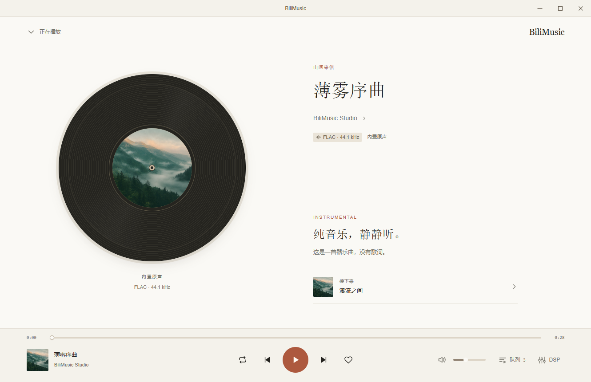
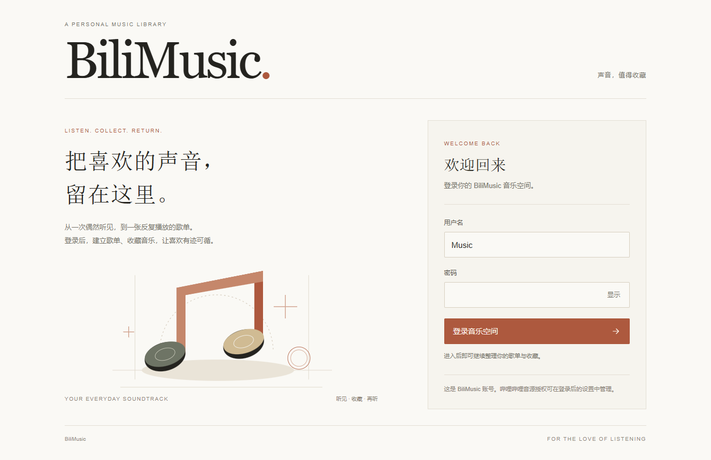

# BiliMusic

BiliMusic 支持哔哩哔哩、酷我、网易云音乐和 Radio Paradise 无损电台，提供 Windows 桌面应用、iOS 自建工程和 PWA。

仓库：<https://github.com/mmiamor/BiliMusic>

## 0.4.1

- 播放页改为铺满应用内容区的静态黑胶布局，左侧唱片封面、右侧歌曲与同步歌词，底部播放控制固定可见。
- 移除宽标签栏；队列与 DSP 由底部入口按需展开，按 Esc 先收起工具，再返回资料库。纯音乐显示器乐说明与下一首，窄屏使用纵向布局。
- 保持纸白、赭红、衬线标题、无动画和 Windows 右侧窗口按钮。见 [播放页设计](docs/player-design.md)。
- 修复 Windows 内置试听音频的进度跳转：静态音频提供完整字节范围响应，拖动进度和点击歌词后可以稳定停在目标位置。



## 0.4.0

- 按 [MMiAmor](https://mmiamor.website/) 的纸白、墨黑、赭红与衬线标题重新统一界面，包含登录、发现、播放器、歌单、设置和 DSP；保留无动画与右侧窗口控制。
- DSP 按原 Apple Music HiFi 重建：24 段参数 EQ、频响曲线、AutoEQ/APO 导入导出、个人预设、自动前级、Crossfeed、声道矩阵、前视限幅与实际音频计量。旧十段设置自动迁移，旁通保留主音量。详见 [DSP 说明](docs/dsp-rebuild.md)。
- 网页版提供独立音乐账号登录；SQLite 保存账号、会话与歌单。管理员可查看数据库统计、账号列表和创建成员，初始账号通过服务器私有配置初始化。
- 新增歌单创建、重命名、描述、曲目加入/移除/排序和整单播放。网页版登录后保存在账号；原生应用保存在本机。详见 [账号与歌单](docs/accounts-playlists.md)。

## 0.3.3

- Windows 窗口按钮移到右上角，顺序为最小化、最大化/还原、关闭。浅色界面保持无动画。
- 侧栏新增“设置”，集中管理哔哩哔哩官方登录、账号状态刷新与退出登录。手机窄屏底栏也可进入设置。
- 设置页支持选择下次启动的发现分类、开关 DSP 和打开调音台，显示当前平台与版本。
- 关闭登录窗口后重新确认账号；查询失败单独显示，不会误报退出。账号发生变化时，重新获取音质和当前 B 站音轨。

## 0.3.2

- B 站首页默认“Hi-Res 优先”：候选内容立即显示，每页后台核验前六首新投稿，当前账号返回且设备支持解码的 Hi-Res 优先排序。标题中的 Hi-Res/无损字样只作为搜索线索，不作为认证。
- 音质证据区分 Hi-Res 档位、普通无损、当前有损、设备不支持与尚未确认；不会凭 FLAC 推定 24 bit / 96 kHz。账号切换会失效证据，实际播放重新解析。
- 新增“Hi-Fi 音源”页，接入 Radio Paradise 四个官方 Ogg FLAC 直播频道，明确标注 16 bit / 44.1 kHz CD 无损并禁用进度拖动。Windows 和 PWA 可在应用内收听；iOS 原生版暂转官方页面。
- Qobuz、TIDAL、QQ 音乐提供明确标识的外部官方入口，尚未接入本应用播放器。平台可用性与接入条件见 [Hi-Fi 音源核验](docs/hifi-sources.md)。

## 0.3.1

- 发现页展示真实的哔哩哔哩音乐投稿，提供热门、最新、现场、翻唱、演奏、原创六类，支持刷新和分页。热门限定近 30 天并按播放量排序。
- 重新调整侧栏、字号、留白、横向封面卡、播放详情和底部控制；首页去掉重复标题，最近播放可直接继续收听。
- 分类保留独立缓存，刷新失败保留已有内容。推荐和最近播放使用各自的队列，异步响应不会覆盖正在浏览的分类。

此前版本已完成：

- macOS 风格的浅色界面与原创音符图标，移除二次元装饰、渐变氛围背景和界面动画。
- 播放详情采用双栏布局：左侧保留歌曲、封面、进度和主控制；右侧切换歌词、队列和十段 DSP。小窗口改为纵向布局。
- 修复 Windows 读取哔哩哔哩合集时的 `net::ERR_BLOCKED_BY_CLIENT`，保留平台会话和域名白名单。

本仓库是当前开发源码，服务器部署需单独确认。早期界面取舍见 [设置页设计](docs/settings-design.md)、[发现页设计](docs/discovery-design.md) 与 [播放页设计](docs/player-design.md)。



[查看新版发现页示例](docs/discovery-0.4.webp) · [歌单页示例](docs/playlists-0.4.webp) · [DSP 调音台](docs/dsp-0.4.webp)

## Windows

需要 Node.js 24。在仓库根目录执行：

```powershell
npm ci
npm test
npm start
```

生成 Windows x64 便携包：

```powershell
npm run dist:win
```

输出位于 `dist/`。完整解压 ZIP 后运行 `BiliMusic.exe`。应用未签名；收藏与平台登录会话保存在当前设备的应用配置目录。

## iOS

仓库包含完整 Xcode 工程和 IPA 构建脚本。需要 macOS 与 Xcode 16 或更新版本，最低支持 iOS 16。

```sh
bash scripts/build-ipa.sh unsigned
# 本机已有开发团队与签名配置时：
TEAM_ID=YOUR_TEAM_ID BUNDLE_ID=com.yourname.bilimusic bash scripts/build-ipa.sh signed
```

也可打开 `ios/BiliMusic.xcodeproj`，设置自己的 Team 与 Bundle Identifier 后连接设备运行。未签名 IPA 需使用自己的 Apple 身份和适用的设备描述文件签名；本轮未进行 Xcode 编译或真机验收。

GitHub 的 **Actions → BiliMusic build → Run workflow** 可选择 `ios`、`windows` 或 `both`。文件保存到该次运行的 Artifacts，不会发布网站或创建公开 Release。

## 使用

- 首页推荐来自音乐分区搜索，按页面注明的范围和排序展示。投稿能否播放与实际音质取决于平台返回的音轨和当前账号权限。
- 首页底部的“离线试听”保留《山间来信》三首原创合成器试听曲，格式为 16 bit / 44.1 kHz FLAC。
- 哔哩哔哩支持关键词、BV、AU、分 P 链接、UP 主投稿及公开合集；官方登录后重新解析账号有权播放的音轨。
- 酷我支持歌曲、歌手、专辑与同步歌词。音质以平台实际返回的格式为准。
- 网易云支持歌曲、歌手、专辑、歌词、热门与最新评论。播放限制不影响公开评论的查看。
- 歌曲、作者、合集、歌手和专辑可分别收藏。歌词支持原文、可用注音/译文和点击定位。
- DSP 提供参数均衡、自动前级、耳机 Crossfeed、声道调整与限幅，设置实时作用于音频。

## PWA

`src/` 与原生应用共用界面，`pwa/` 提供同源会话和流媒体服务。独立验证：

```sh
cd pwa
npm ci
npm test
```

部署时需自行配置 HTTPS 域名、反向代理及服务管理。仓库不包含原运行环境的 DNS 凭据、主机配置或自动部署任务。

服务器需要 Node.js 22.13 或更新版本。配置 `PUBLIC_ORIGIN`、`BILIMUSIC_DB_PATH` 和首次初始化用的 `BILIMUSIC_ADMIN_USERNAME` / `BILIMUSIC_ADMIN_PASSWORD`（或 `BILIMUSIC_ADMIN_PASSWORD_HASH`）。密码仅通过私有环境配置传入，已有数据库不会被初始化参数覆盖。数据库与备份必须放在发布目录之外，不能打包到静态资源或 GitHub。

## 项目结构

| 路径 | 内容 |
| --- | --- |
| `src/` | 播放界面、音源、歌词、资料库、DSP、PWA 缓存 |
| `windows/` | Electron 窗口、隔离桥、网络与官方登录 |
| `ios/` | Swift / WKWebView 工程与音频桥 |
| `pwa/` | 网页会话及流媒体服务 |
| `tests/` | 播放器、音源、歌词、资料库、评论和 Windows 请求回归 |
| `scripts/` | IPA 构建、图标导出及原创试听曲生成 |
| `docs/` | 播放页原型、设计说明与验证截图 |
| `.github/workflows/` | 自动测试及手动应用构建 |

图标矢量源为 `src/icons/app.svg`。安装 `PyMuPDF` 和 `Pillow` 后，执行 `python scripts/export-native-icons.py` 可重新导出 PNG、ICO 与 iOS AppIcon。

参考、素材来源和第三方库许可见 [设计与音源说明](docs/design.md) 与 [pinyin-pro 许可说明](src/vendor/pinyin-pro/PROVENANCE.md)。
