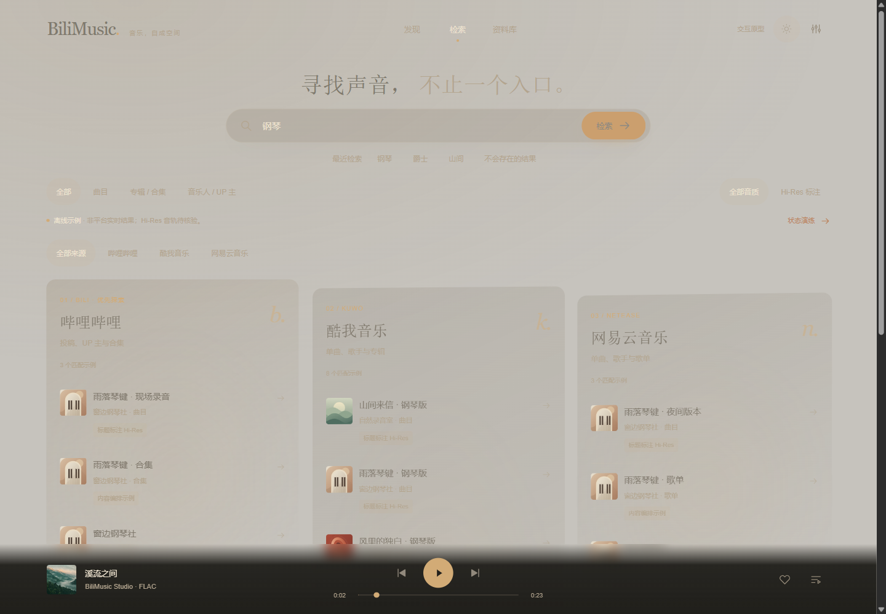

# BiliMusic · 音乐空间

完整的离线 UI 交互方案：把发现、跨来源检索、资料库与空间唱片放进同一个连续的音乐环境。

[打开原型](index.html) · [交互与实现说明](design-notes.md) · [独立空间播放器](../spatial-player/README.md)

## 页面与路径

| 页面 | 可以体验的内容 |
| --- | --- |
| 发现 | 原创 EP、可切换的主题歌单、歌曲试听、音乐人入口。 |
| 多源检索 | 输入一个词，分别展开 BILI、酷我、网易云的结果视面；来源、内容类型与 Hi-Res 标注筛选。 |
| 来源状态 | 每个来源独立加载、空结果、失败、重试；可以通过状态演练查看不同组合。 |
| 资料库 | 自建歌单、喜欢的声音、最近播放，存储在当前浏览器。 |
| 歌单详情 | 创建、改名、添加、移除、删除、保存主题歌单，按歌单内可试听曲目的顺序播放。 |
| 音乐人 | BiliMusic Studio 介绍与三首原创作品。 |
| 设置 | 日夜主题、减少动态、Hi-Res 标注优先、账号入口、本地资料导出。 |
| 登录与授权 | 明确标注的表单和官方授权流程预览，不发送或保存凭据。 |
| 空间播放器 | 真实 FLAC 试听、3D 唱片、歌词视觉演示、队列与 DSP 界面，共用单一音频状态。 |

[手机检索](search-mobile.webp) · [资料库](library.webp) · [设置](settings.webp) · [手机登录入口](login-mobile.webp)

## 内容的真实性

三首 BiliMusic Studio 内置器乐能够真实播放。平台检索来自本地示例目录，**不是实时平台结果**。输入「钢琴」「山间」「人声」「爵士」「雨」等关键词可以体验匹配和筛选，其他词可能返回空结果。

「标题标注 Hi-Res」只表达示例的标题标记，不保证音轨质量。FLAC / 44.1 kHz 内置试听也没有被标为 Hi-Res。无音轨的示例条目支持查看、收藏和编入歌单，不会替播不相干的试听曲目。登录和 DSP 仍为原型界面。

## 直接打开

使用浏览器打开 `index.html`，无需服务器、账号或外部 CDN。保留仓库目录结构，以读取内置媒体和相邻的空间播放器。整套原型另有包含图片、音频和全部页面的离线 ZIP。

修改空间播放器的 HTML 后，运行 `node scripts/build-concept-embed.mjs` 更新嵌入文档。生产 `src/`、Windows 安装包和线上服务未在此方案中替换。

打包：运行 `python scripts/package-music-space.py`，输出至 `dist/BiliMusic-Music-Space-Prototype.zip`。

## 已验证

Ego 浏览器中验证了来源独立成功/失败/空结果、单源重试与新词覆盖旧请求；创建、转义名称、刷新保留与删除歌单；真实媒体播放、进度、队列顺序、末尾停止和切页续播。主题、收藏和动效在大播放器与页面间同步，夜间偏好在刷新及快速切换后保持稳定。

12 项偏好、焦点与登录检查、9 项播放器/队列检查通过；390×844 和 320×640 下六个主要页面均无横向溢出、主要按钮至少 44px，底部播放控制保持可见。另目视检查了发现、检索、资料库、设置和登录场景。没有启动站点服务或调用真实平台账号。
