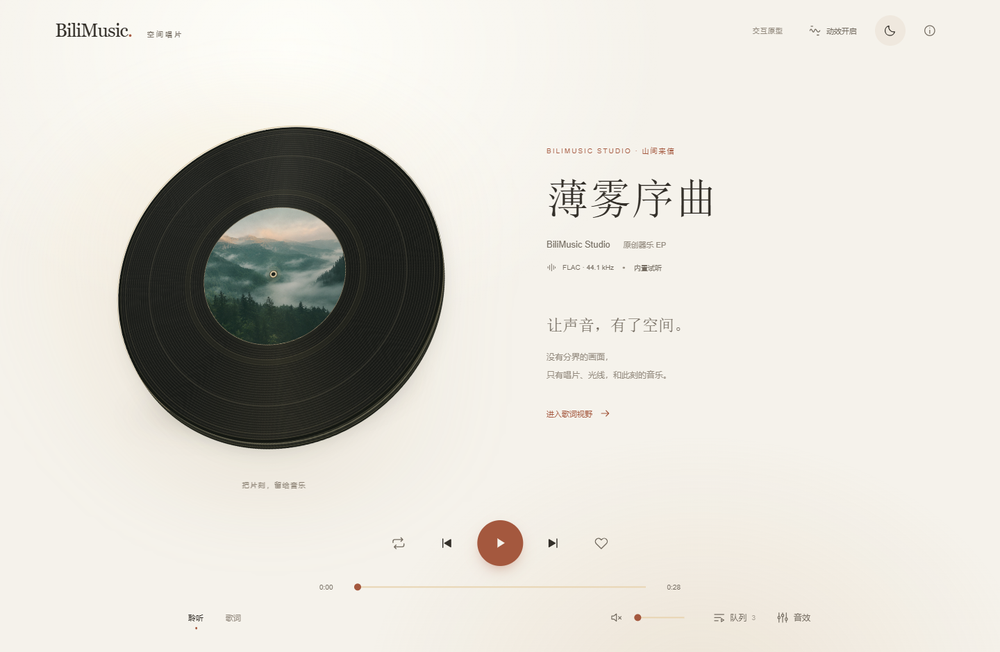
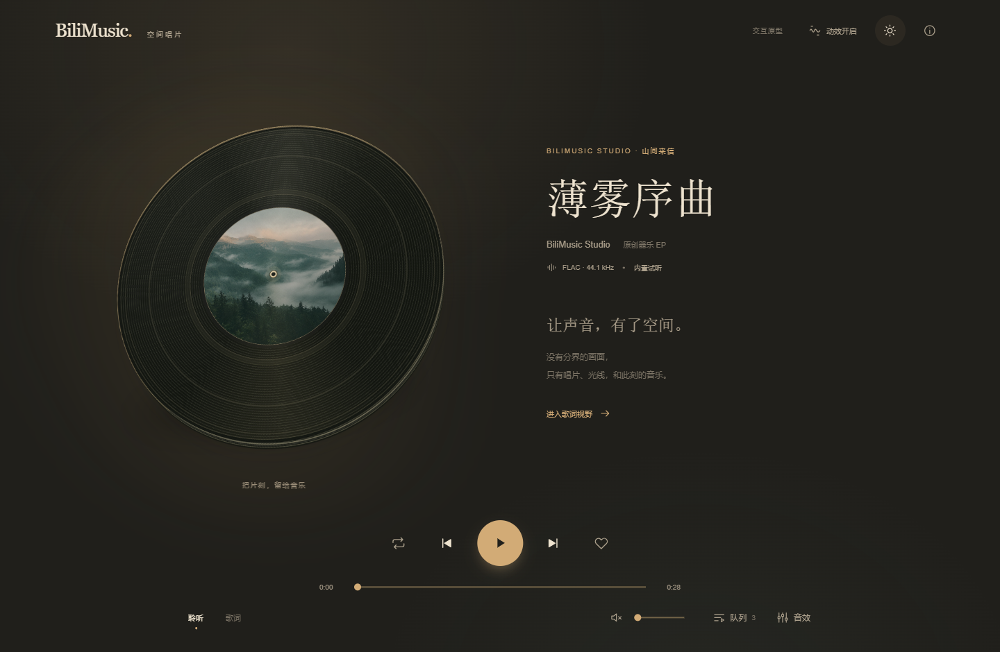

# BiliMusic · 空间唱片

这是一套可运行的 UI 方案，用连续光线、立体材质与状态动效取代硬分区。设计保留暖纸、墨色、赭红和衬线标题，并提供暖墨夜间场景。

[打开交互原型](index.html) · [设计与动效说明](design-notes.md)

[手机聆听页](mobile.webp) · [手机歌词演示](lyrics-mobile.webp)

## 交互结构

| 场景 | 表现 |
| --- | --- |
| 聆听 | 悬浮唱片、歌曲信息与播放控制处于同一连续画面，无固定底栏背景或分隔线。 |
| 播放 / 暂停 | 与真实音频状态连接，唱片缓起旋转、暂停缓停，角度连续。 |
| 切歌 | 音频命令立即执行，唱片与文字短暂抬起淡出，动画不覆盖后续暂停。 |
| 歌词 | 唱片退到后方，文字进入前景；当前曲目无歌词时如实说明，可单独预览演示文本的过渡。 |
| 队列 | 右侧展开，播放控制保持原位；选曲后保留键盘焦点，Esc 返回入口。 |
| 音效 | 展示预设、曲线和三组可调参数；此原型不处理音频，正式接入时复用既有 DSP 引擎。 |
| 手机 | 唱片、歌词、工具共用主区域；控制固定可见，工具内容独立滚动。 |
| 减少动态 | 遵循系统偏好，也可手动关闭；取消旋转、视差和已启动的歌词动画，声音继续播放。 |

## 运行与验证

直接使用浏览器打开 `index.html`，无需 HTTP 服务、构建工具或外部 CDN。保持该目录在仓库中的相对位置，以读取 `src/assets/` 的内置图片和三首原创 FLAC。

原型含真实试听、进度与音量、切歌、循环、收藏状态、队列、昼夜光线、视差和歌词动效。收藏仅保存在本次页面会话；歌词演示与 DSP 外观明确标注用途，没有伪造同步歌词或音效处理。

使用 Ego 浏览器检查了 1440×940、390×844、320×640；11 项定向验证通过，包含切歌时暂停优先、真实音频 seek、队列焦点、Esc 返回、运行中减少动态、音效状态恢复、手机无横向溢出与控制可见。另目视检查了昼夜、歌词与音效场景。测试时音频静音，未启动服务器或访问账号。

本目录独立于生产 `src/`，尚未替换 Windows 应用或部署到线上。跨设备帧率和电量表现仍需正式集成后的基准验证。
