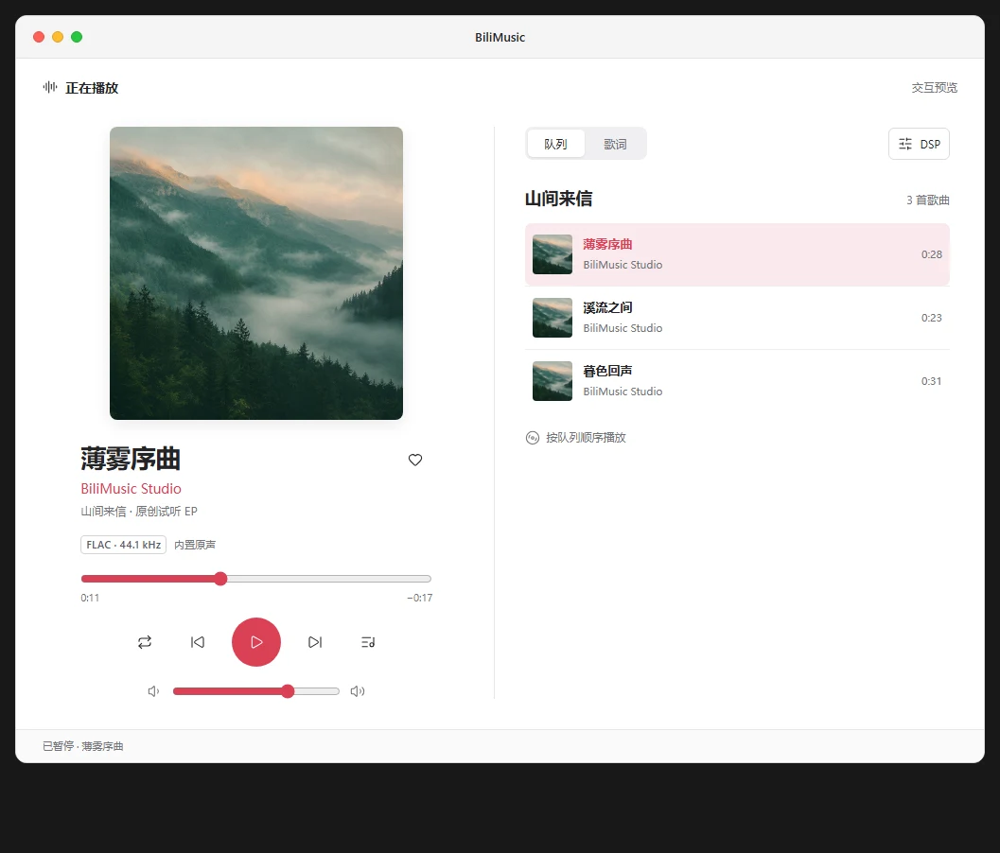

# macOS 风格播放页

[可点击原型](player-prototype.html) · [实际桌面播放页](macos-player.webp) · [实际 DSP](macos-dsp.webp)

播放页使用固定浅色界面，灰白背景与珊瑚红强调色。窗口顶部沿用红、黄、绿三个控制点；移除二次元角色、紫色氛围背景、旋转唱片和所有界面动画。

桌面界面采用双栏：左栏显示封面、完整歌曲名、作者、专辑、实际音质、进度及主播放控制；右栏在歌词与队列之间切换。DSP 在右栏内展开，保留左侧控制。歌曲标题允许换行，封面大小受可用宽度限制，避免窄高弹窗把进度和主控制挤到视口之外。

小于 680 像素时改为纵向排列，先显示当前歌曲与播放控制，再显示队列、歌词或调音台；触屏按钮最小有效区域为 44 像素。

交互原型使用随应用提供的《山间来信》三首器乐曲。器乐曲显示无歌词状态，不提供虚构歌词。原型支持播放/暂停状态、切歌、进度、音量、收藏、循环、歌词/队列切换与十段 DSP 预览；原型不实际播放或处理音频。

实现时应保留现有音频、平台、收藏和歌词逻辑，只调整布局与样式。音质标签继续依据播放器实际解码的音源显示，不因设计稿写有 FLAC 就把其他音源标为无损。
