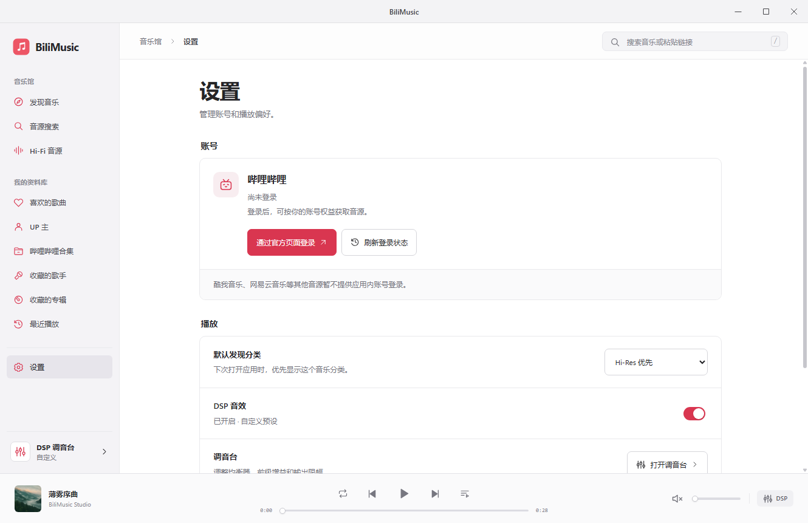

# 0.3.3 验证记录

2026 年 11 月 6 日，Windows / Electron 44.5.1。

- 根目录 93 项测试、PWA 21 项测试通过。新增 12 项账号与偏好测试，覆盖 HTTP/业务失败、无效响应、取消登录、操作去重、失败保留状态、乱序结果与受限储存。
- 右上角窗口控件 20 项原生检查通过：按钮顺序、最大化/还原、拖拽区与标题双击、失焦、弹窗内点击/键盘/最小化，以及最终关闭独立测试窗口。
- 设置页固定响应回归 33 项通过：登录/取消/退出、查询失败与重试、重复点击、账号变化时音轨重解析，以及旧解析不能覆盖新会话。取消登录保留当前曲目、队列、进度和默认分类。
- 1330、980、430 像素窗口没有横向溢出；设置控件触达尺寸至少 44 像素，底部播放控制保留。默认分类在重载后生效；DSP 旁通保留原参数，并同步侧栏与调音台。
- 真实匿名会话 5 项检查通过：官方账号接口确认未登录，设置按钮打开官方登录窗口；关闭窗口后重新查询仍为未登录，没有调用退出、重播或清空会话。应用控制台及模块错误为零。
- 本次没有登录或退出用户的真实账号。成功登录、退出和失败分支使用明确的固定响应验证；官方实测范围是匿名状态查询与登录窗口打开/取消。
- PWA 测试通过内存请求处理器运行，没有启动 HTTP 服务。iOS 未进行编译或真机验收，未执行站点部署。
- Windows 0.3.3 便携包已构建。`app.asar` 中 57 个运行文件逐一与源码相符，ZIP 完整性校验通过，包内 EXE 与 ASAR 和解压目录一致。

[查看窄屏设置页](settings-mobile.webp)

---

# 0.3.2 验证记录

2026 年 11 月 6 日，Windows / Electron 44.5.1。

- 根目录 81 项测试、PWA 21 项测试通过，新增音质证据、并发/超时/账号隔离、稳定排序、固定电台来源、直播代理和禁止 seek 的回归。
- 固定响应的原生应用回归 19 项通过：候选先显示、已确认且设备支持的 Hi-Res 优先、AAC/未知不误标；后台排序不会改变已打开详情的队列或卡片对应曲目，旧核验不覆盖新请求。
- 实际匿名 B 站会话返回 20 条 Hi-Res 关键词候选，前 6 条完成音轨核验，本轮均实际返回 AAC。应用全部如实显示“当前返回 AAC”，未将标题宣传变成 Hi-Res 标记。本次没有把该匿名实测视为真实 Hi-Res 播放证明。
- Radio Paradise 四个官方 HTTPS 频道分别做了少量流头读取：Ogg FLAC，16 bit / 44.1 kHz，双声道。主频道在原生应用实播成功，时间从约 0.044 秒推进至 3.561 秒；测试音量为零，没有主观听音评价。另一个独立解码检查确认 WebAudio 收到非零音频样本。
- 电台在底栏和完整播放页都禁用进度拖动，合成滑块 change 不改变直播位置；切回 B 站发现页保留当前电台队列和播放状态。
- 1330、980、430 像素窗口检查无横向溢出，实际及固定响应检查的 console/module 错误均为零。
- PWA 通过内存请求处理器验证会话媒体代理、Ogg MIME、无 Range 直播、固定地址及跳转限制；没有启动 HTTP 服务。iOS 原生桥仅新增固定官网入口，电台在媒体下载前跳转官方页；未进行 Xcode 编译或 iOS 真机验收。

播放器显示的是音源格式；本机独立解码测试的 AudioContext 为 48 kHz，不据此承诺硬件独占或 bit-perfect。所有站点部署均未执行。音源官方依据见 [Hi-Fi 音源核验](hifi-sources.md)。

---

# 0.3.1 验证记录

2026 年 11 月 6 日，Windows / Electron 44.5.1。

- 根目录 55 项测试、PWA 14 项测试通过，覆盖发现页分区和分页、缓存、乱序响应、失败刷新、后续播放登记、登录切换后缓存失效及原有播放器行为。
- 独立匿名 Electron 会话实测热门、原创各返回 20 条音乐投稿。热门请求限定近 30 天、按播放量排序，不使用旧音乐排行榜快照。
- 热门首曲实播成功，平台返回 AAC · 216 kbps，进度增长且可暂停；另一次选中的投稿未返回可解码独立音轨，应用正确显示限制与其他音源搜索入口。不将全部推荐视为保证可播放或无损。
- 1330 × 860、980 × 760、430 × 780 实际窗口无水平溢出；截图等待可视封面解码完成。修复移动首图收缩，手机首图保持 16:9。
- 固定响应回归验证：分页去重并保留滚动位置、快速切分类后只显示当前分类、离开首页后回包不覆盖搜索、返回首页复用缓存、刷新失败保留旧内容、重试恢复。
- 卡片直接点播、详情点播均使用对应的推荐队列；最近播放独立使用历史队列。播放重绘不重复请求推荐，异步重绘保留分类键盘焦点。固定响应音频使用内置 FLAC，独立于上述真实投稿实播检查。
- 发现页交互原型使用显著标注的本地示例；桌面与窄屏无溢出，分类、刷新、播放、收藏、导航与搜索交互通过。

没有启动或部署站点服务；iOS 工程版本已同步，但本轮未运行 Xcode 或真机验收。

---

# 0.3.0 验证记录

2026 年 11 月 6 日，Windows / Electron 44.5.1。

- 播放器、音源、歌词、收藏、评论与 Windows 请求：33 项自动测试通过。
- PWA 会话、静态资源、音频 Range、平台隔离与评论：10 项自动测试通过。
- 1330 × 860 和 430 × 640 实际 Electron 窗口无水平溢出，页面无活动动画。
- DSP 弹窗打开期间，标题栏可点击；实际验证最大化、恢复、最小化及关闭。
- 内置 FLAC 成功播放，进度增长且暂停正常。
- 双栏播放页可切换队列、歌词与 DSP，预设修改后保留左侧控制；窄屏 DSP 单一滚动，底部增益与限幅控件可操作。
- 使用明确标注的固定长标题和测试歌词进行排版检查：三行标题下主播放控制仍在可见区域，歌词列表独立滚动。这不是在线歌曲歌词验证。
- 实际匿名 Electron 请求读取 B 站索尼音乐中国（486906719），返回 5 个合集；首个合集（8151284）读取到 20 首曲目。修复前同一请求返回 `ERR_BLOCKED_BY_CLIENT`。

iOS 工程与构建工作流已包含在仓库，但本轮未运行 Xcode、签名或真机测试。没有执行站点部署。
